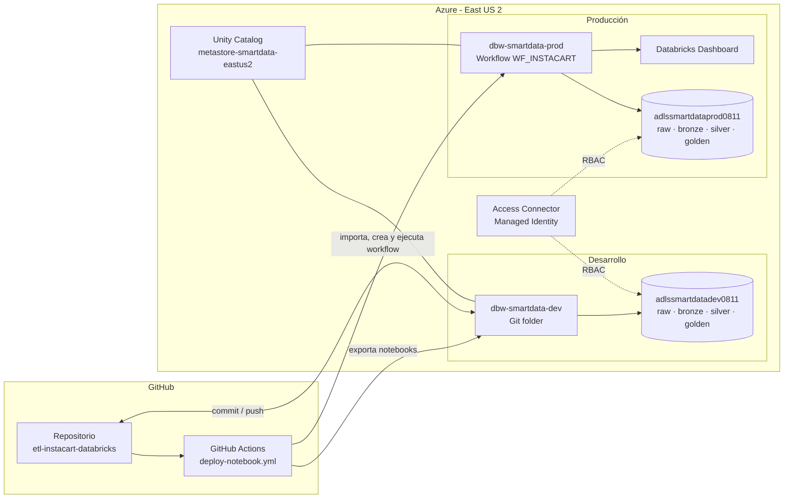

# ETL Medallion con Azure Databricks — Instacart

> **Trabajo Final — Ingeniería de Datos con Databricks (DataSmart)**
> Autor: Johan Céspedes

Pipeline ETL con arquitectura **Medallion** (Raw → Bronze → Silver → Golden) sobre **Azure Databricks + Unity Catalog**, escrito en **PySpark**, con acceso al Data Lake **solo por Managed Identity**, desplegado de **desarrollo a producción con GitHub Actions** y consumido desde un **Databricks Dashboard**.

**Fuente de datos:** [Supermarket/Superstore dataset bundle (Instacart) — Kaggle](https://www.kaggle.com/datasets/amunsentom/supermarket-superstore-dataset-bundle)

---

## 1. Preguntas de negocio

El modelo se diseñó **de atrás hacia adelante**: cada tabla Golden responde una pregunta, y Silver prepara exactamente lo que Golden necesita.

| Pregunta | Tabla Golden |
|---|---|
| ¿Qué departamentos y pasillos venden más y tienen clientes más fieles (recompra)? | `kpi_departamentos` |
| ¿Qué días y a qué horas compra la gente? | `kpi_habitos_compra` |
| ¿Cuáles son los productos "estrella" de recompra? | `top_productos_recompra` |
| ¿Qué tipos de clientes tenemos? | `segmentacion_clientes` |

## 2. Arquitectura



**Workflow productivo `WF_INSTACART`** (las 4 ingestas corren en paralelo):

```
                        ┌─ 2.Ingest_orders ──────────┐
1.Preparacion_Ambiente ─┼─ 2.Ingest_order_products ──┼─→ 3.Transform → 4.Load → 5.Grants_Medallion
                        ├─ 2.Ingest_products ────────┤
                        └─ 2.Ingest_catalogos ───────┘
```

## 3. Servicios utilizados

| Servicio | Recurso | Uso |
|---|---|---|
| Resource Group | `rg-smartdata-tf` | Agrupa todos los recursos (metadatos en East US; recursos en East US 2) |
| ADLS Gen2 (dev) | `adlssmartdatadev0811` | Data Lake de desarrollo: `raw`, `bronze`, `silver`, `golden`, `metastore`, `ucmetastore` |
| ADLS Gen2 (prod) | `adlssmartdataprod0811` | Data Lake de producción: `raw`, `bronze`, `silver`, `golden`, `metastore` |
| Access Connector for Azure Databricks | `ac-smartdata-tf` | **Managed Identity** (system-assigned) para acceder al Data Lake |
| Azure Databricks (dev) | `dbw-smartdata-dev` (Premium) | Desarrollo; Git folder conectada al repositorio |
| Azure Databricks (prod) | `dbw-smartdata-prod` (Premium) | Ejecución del workflow productivo y dashboard |
| Unity Catalog — Metastore propio | `metastore-smartdata-eastus2` | Creado desde la consola de cuenta (reemplaza al creado por defecto), asignado a dev y prod |
| Unity Catalog — objetos | `cred-smartdata`, `exlt-{ambiente}-{contenedor}`, `catalog_dev`, `catalog_prod` | Credencial, External Locations, catálogos, schemas, tablas y permisos |
| Databricks Workflows | `WF_INSTACART` | Orquestación del ETL en producción (8 tareas, reintentos) |
| Databricks SQL (Serverless) + Dashboard | Serverless Starter Warehouse | Visualización de la capa Golden |
| GitHub + GitHub Actions | Este repositorio | Control de versiones y CI/CD dev → prod |

## 4. Seguridad

### 4.1 Conexión al Data Lake solo por Managed Identity

```
Databricks → Unity Catalog → Storage Credential (cred-smartdata)
           → Access Connector (ac-smartdata-tf) → RBAC "Storage Blob Data Contributor" → ADLS Gen2
```

- Sin account keys, SAS tokens, DBFS ni Volúmenes para la capa raw.
- Rol RBAC con **mínimo privilegio**: solo `Storage Blob Data Contributor`, asignado sobre cada storage account.
- Cada contenedor está cubierto por una **External Location** (`exlt-dev-raw`, `exlt-prod-bronze`, …).

### 4.2 Permisos por capa (notebook `5.Grants_Medallion`)

Los consumidores (`account users`) solo pueden **leer la capa Golden**: `USE CATALOG` → `USE SCHEMA golden` → `SELECT`. Bronze y Silver quedan reservadas al equipo de ingeniería.

### 4.3 Secretos del CI/CD

Los hosts y tokens de Databricks se guardan como **GitHub Secrets** cifrados (`DATABRICKS_ORIGIN_HOST/TOKEN`, `DATABRICKS_DEST_HOST/TOKEN`); nunca aparecen en el código. Los tokens tienen vigencia de 90 días y *auto-scoping* activado.

## 5. Datos

### 5.1 Modelo

```
departments (21) ─┐                 ┌─ aisles (134)
                  └──► products (49.688) ◄┘
                            │
                     order_products (2.097.150)   ← hecho: 1 producto en 1 pedido
                            │
                       orders (1.048.575)         ← 1 pedido: cliente, día, hora
                            │
                       user_id (63.100 clientes)
```

| Archivo raw | Formato | Tabla Bronze |
|---|---|---|
| `orders.csv` | CSV `;` | `bronze.orders` (particionada por `eval_set`) |
| `order_products__prior.csv` + `__train.csv` | CSV `;` | `bronze.order_products` (unión, particionada por `origen`) |
| `products.csv` | CSV `;` | `bronze.products` |
| `aisles.json`, `departments.json` | JSON (arreglo) | `bronze.aisles`, `bronze.departments` |

> En `datasets/` los CSV grandes se incluyen comprimidos (`.zip`) por el límite de 25 MB de carga web de GitHub.

### 5.2 Hallazgos de calidad y reglas aplicadas

El análisis está en [`exploracion/0.Exploracion_Calidad`](exploracion/0.Exploracion_Calidad.py). Cada regla se registra en `silver.calidad_datos` en cada ejecución.

| # | Hallazgo | Acción | Registros (ejecución real) |
|---|---|---|---|
| 1 | Separador `;` y saltos de línea Windows (`\r\n`) | **Corregir** la lectura (`sep=";"`) | — |
| 2 | Archivos truncados en **1.048.575 filas** (límite de Excel) | **Documentar** | — |
| 3 | Productos partidos por un `;` dentro del nombre (`&#39;`), reparables desde la columna extra | **Corregir** con expresión regular | 2 |
| 4 | Productos sin pasillo/departamento irreparables | **Marcar** y asignar a `missing` (pasillo 100, depto. 21) | 9 |
| 5 | Código HTML `&#39;` en nombres | **Corregir** → `'` | 2 |
| 6 | `days_since_prior_order` nulo | **Marcar** `es_primer_pedido` (coincide exactamente con el número de clientes) | 63.100 |
| 7 | Detalles de pedido sin pedido en `orders` (por el truncamiento) | **Descartar** con inner join | 1.458.558 |
| 8 | Duplicados por llave | Regla **defensiva** `dropDuplicates` | 0 |

**Supuesto documentado:** `order_dow` 0 = Domingo (Instacart no lo especifica).

## 6. Capas del ETL

| Capa | Tablas | Qué contiene |
|---|---|---|
| **Raw** | Archivos en el contenedor `raw` | Fuente original, sin cambios |
| **Bronze** | `orders`, `order_products`, `products`, `aisles`, `departments` | Delta con esquema explícito + auditoría (`archivo_origen` vía `_metadata.file_path`, `ingestion_date`). No se limpia |
| **Silver** | `products`, `orders`, `order_items`, `calidad_datos` | Datos reparados, enriquecidos (día, franja horaria) y unidos; `order_items` es la tabla de hechos |
| **Golden** | `kpi_departamentos`, `kpi_habitos_compra`, `top_productos_recompra`, `segmentacion_clientes` | Agregados para el negocio |

Todas son **tablas Delta externas** (`LOCATION` en el contenedor de su capa), escritas con `overwrite` → el proceso es **idempotente** (se puede reejecutar sin duplicar). Cada ingesta valida con `assert` que las filas leídas sean iguales a las escritas.

## 7. Resultados

**Segmentación de clientes** (63.100 clientes):

| Segmento | Regla | Clientes | Pedidos promedio | Compra cada |
|---|---|---|---|---|
| Frecuente | 20+ pedidos y cada ≤ 10 días | 9.903 (16 %) | 47,1 | 6,9 días |
| Ocasional | 8+ pedidos | 30.564 (48 %) | 15,1 | 15,2 días |
| Esporádico | resto | 22.633 (36 %) | 5,3 | 19,4 días |

Los umbrales son reglas de negocio definidas para este análisis y se ajustan en un solo lugar (`4.Load`).

## 8. Estructura del repositorio

```
├── .github/workflows/deploy-notebook.yml   CI/CD dev → prod
├── PrepAmb/          Preparación del ambiente (external locations, catálogo, schemas, tablas)
├── proceso/          Notebooks del workflow productivo (se despliegan a prod)
├── seguridad/        Grants por capa
├── reversion/        Rollback: elimina catálogo, datos y (opcional) external locations
├── exploracion/      Análisis de calidad previo al diseño (no se despliega)
├── datasets/         Archivos fuente
├── dashboard/        Dashboard exportado (.lvdash.json)
├── evidencias/       Capturas de la ejecución
├── certificaciones/  Certificaciones obtenidas
└── README.md
```

## 9. CI/CD

**Flujo de trabajo:**

1. Desarrollo en la **Git folder** del workspace dev, en una rama de trabajo (`construccion`).
2. *Commit & push* desde Databricks → **Pull Request** a `main` → revisión → merge.
3. El push a `main` (solo si cambian `proceso/**` o el workflow) dispara **GitHub Actions**, que:
   1. **Exporta** los 8 notebooks de dev por la API de Databricks (valida que cada exportación sea un notebook real).
   2. Los **importa** en prod en `/Shared/etl-instacart/proceso`.
   3. **Recrea** el workflow `WF_INSTACART` con parámetros de producción (`adlssmartdataprod0811`, `catalog_prod`) sobre el cluster `cluster-smartdata`.
   4. Lo **ejecuta** y **monitorea** hasta que termina (falla el pipeline si alguna tarea falla).

El workflow queda con un horario diario (06:00 America/Guatemala) **pausado**, y con `max_retries` por tarea.

## 10. Cómo ejecutar

1. Crear la infraestructura de la sección 3 y asignar el rol RBAC a la Managed Identity.
2. Crear `cred-smartdata` en Unity Catalog con el Resource ID del Access Connector.
3. Subir los archivos de `datasets/` (descomprimidos) al contenedor `raw` de cada storage.
4. Crear `cluster-smartdata` en prod (17.3 LTS, single node, `Standard_D4ds_v5`).
5. Configurar los 4 GitHub Secrets y hacer push a `main` (o ejecutar el workflow manualmente desde *Actions*).

## 11. Decisiones técnicas

| Decisión | Motivo |
|---|---|
| Dos storage accounts (dev y prod) | Aislar los datos de producción |
| External Locations con sufijo de ambiente | Dev y prod comparten el metastore regional; los nombres deben ser únicos |
| Metastore propio desde la consola de cuenta | Control de la raíz de almacenamiento y de la asignación de workspaces |
| Workspaces **Premium** | Unity Catalog requiere Premium; el tier Trial no está permitido en suscripciones Free Trial |
| Runtime **17.3 LTS** igual en dev y prod | Comportamiento idéntico entre ambientes |
| Cluster single node 4 cores, sin Photon, auto-apagado 20 min | Cuota de 4 vCPU de la suscripción gratuita y control de costos (1 DBU/h) |
| Esquema explícito en la ingesta | Evita lecturas extra de `inferSchema` y controla tipos |
| `insertInto` + `overwrite` + `assert` | Idempotencia y validación automática de conteos |
| PrepAmb idempotente con `reset` opcional | No destruye producción en cada ejecución |
| Un notebook de ingesta por fuente | Paralelismo, aislamiento de fallos y mantenimiento |

## 12. Bitácora de problemas y soluciones

| # | Problema | Causa | Solución |
|---|---|---|---|
| 1 | *"Trial workspace creation is not supported for Azure Free Trial"* | El tier Trial no se permite en suscripciones Free Trial | Workspaces en tier **Premium**, manteniendo el límite de gasto |
| 2 | Cluster: `CLOUD_PROVIDER_RESOURCE_STOCKOUT` | Sin capacidad de `Standard_DS3_v2` en East US 2 | Nodo `Standard_D4ds_v5` |
| 3 | No se podía entrar a la consola de cuenta | La cuenta personal de Outlook es usuario *externo* del tenant | Usuario nativo de Entra ID con rol Global Administrator |
| 4 | Error al crear el metastore (*Access Connector … could not be found*) | Permisos RBAC del administrador y error conocido de la UI con identidades system-assigned | El metastore se creó; se verificó la asignación y el Metastore Admin |
| 5 | Workflow de prod: `AZURE_QUOTA_EXCEEDED_EXCEPTION` | La cuota de 4 vCPU es **compartida** por dev y prod | Un solo cluster encendido entre ambientes; el job **reintentó automáticamente** y terminó con éxito |
| 6 | Carga web a GitHub rechazada | Límite de 25 MB por archivo | Datasets grandes comprimidos en `.zip` |
| 7 | Error al crear la rama desde Databricks (*The link to your GitHub account does not have access*) | La app de Databricks no tenía permiso de escritura sobre el repositorio | Instalación de la *Databricks GitHub App* en el repositorio (acceso solo a este repo) |

## 13. Mejoras futuras

- **Workspace binding** de catálogos (`catalog_dev` solo en dev, `catalog_prod` solo en prod).
- Segmentación **RFM adaptada** (recencia por intervalo entre pedidos, frecuencia, tamaño de canasta como sustituto monetario).
- Carga incremental con **Auto Loader** en lugar de `overwrite` completo.
- Job cluster en lugar de cluster all-purpose para el workflow.

## 14. Evidencias

| Archivo | Qué demuestra |
|---|---|
| `01_recursos_azure_resource_group.png` | Servicios aprovisionados en Azure |
| `02_managed_identity_role_assignment.png` | Rol RBAC de la Managed Identity sobre el storage |
| `03_metastore_unity_catalog.png` | Metastore propio asignado a dev y prod |
| `03b_storage_credential_managed_identity.png` | Storage Credential de tipo Managed Identity |
| `04_test_connection_external_location.png` | Conexión Unity Catalog → Data Lake verificada |
| `05_cluster_configuracion.png` | Configuración del cluster |
| `06_calidad_datos_silver.png` | Bitácora de calidad de datos |
| `07_workflow_prod_exitoso.png` | Workflow `WF_INSTACART` ejecutado con éxito en producción |
| `08_github_actions_exitoso.png` | Pipeline de GitHub Actions exitoso |
| `09_dashboard.png` | Dashboard sobre la capa Golden |
| `10_pull_request_construccion_a_main.png` | Pull Request #1 `construccion` → `main` (cambio probado en dev, revisado e integrado) |
| `11_github_actions_despliegue_pr.png` | Despliegue automático a producción disparado por el merge del Pull Request |
| `12_workflow_prod_despliegue_pr.png` | Workflow en producción con la nueva validación de Golden, sin reintentos (un solo cluster encendido) |
